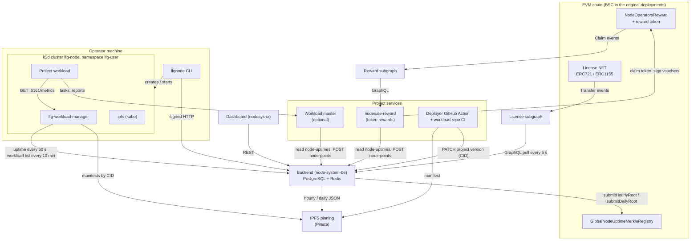

# Nodesystem

The nodesystem is a DePIN stack for **license-gated workloads**. People who hold a license NFT run a small
local Kubernetes cluster on their own machine; the cluster runs a project's workload. The system proves
the node was online, turns that into uptime numbers, commits the numbers on-chain as Merkle roots, and
lets the project turn uptime into points or token rewards.

It was operated by LFG as a hosted multi-project service (Valley, Helix, FlipIt, TikTrix, magnetoHR,
Flora). The hosted service is shut down. **The code is now open source (MIT) and each project runs its own
complete copy.** Nothing in the repositories depends on LFG infrastructure; every host, bucket, registry
and key is configuration you supply.

!!! info "How to read these docs"
    These pages are the map between the repositories. Each repository README is the complete reference
    for its own configuration and is linked from the matching page. The code was published as it ran in
    production (only secrets removed and LFG hard-coded values turned into configuration), so
    [known weaknesses](security.md) are documented, not fixed.

**Where to go next**

- Setting up your own copy: [Self-hosting checklist](self-hosting.md).
- Coming from the LFG-hosted system: [Migration from LFG](migration-from-lfg.md).
- Names you must not change: [Fixed names](fixed-names.md).

## Architecture

### Data flow in words

1. **Licenses.** A wallet buys or is airdropped license NFTs. The
   [license subgraph](subgraphs.md#license-subgraph) counts NFTs per wallet; the
   [backend](backend.md) copies those counts into its database every 5 seconds. The number of licenses
   a wallet holds limits how many workloads of that project it may have online.
2. **Running a node.** The operator installs your build of [`lfgnode`](node-cli.md), generates a node
   key (the node's identity is that key's address, not an NFT id), and the wallet that owns the licenses
   links the node address through the dashboard or `POST /nodes`. `lfgnode start` creates a k3d cluster
   with the [workload manager](workload-manager.md) and an IPFS node.
   `lfgnode workload add <code>` asks the backend for the manifest CID and deploys the project
   [workload](workloads.md).
3. **Heartbeats.** The workload pings the workload manager (about every 10 s); the manager reports the
   live workloads to the backend every 60 s, signed with the node key. Every 10 minutes it re-syncs the
   workload list and versions from the backend and applies manifests downloaded from an IPFS gateway.
4. **Summaries and on-chain commitment.** Every hour and every day the backend sums uptime per
   (project code, node), uploads the list to IPFS and submits a Merkle root plus the CID to your
   [registry contract](contracts.md#uptime-registry). Anyone can verify a node's uptime against it.
5. **Points or tokens.** A project service reads yesterday's per-node uptime from the backend and writes
   points back (`node-points`):
    - the sample [workload master](master-and-rewards.md#workload-master-sample) for points-only
      projects (Valley-style);
    - [nodesale-reward](master-and-rewards.md#nodesale-reward) for token projects (Helix- and
      FlipIt-style): it splits the day's tokens, keeps each operator's claimable balance and signs claim
      vouchers for the [`NodeOperatorsReward`](contracts.md#node-operators-reward) contract. The
      [reward subgraph](subgraphs.md#reward-subgraph) reports on-chain claims back to it.
6. **Releasing a workload.** CI in the workload repository builds an image, runs the
   [deployer](workloads.md#deployer-github-action) which uploads the completed manifest to IPFS and
   publishes `{version, CID}` to the backend. Nodes pick up the new version within 10 minutes.

## Repository map

All repositories live in the GitHub organization
[`LFG-Incorporated`](https://github.com/LFG-Incorporated). Fork the ones you need.

| Repository | What it is | Docs |
|---|---|---|
| [`opensource-node-cli`](https://github.com/LFG-Incorporated/opensource-node-cli) | `lfgnode`, the operator CLI (Go) | [Node CLI](node-cli.md) |
| [`opensource-node-system-workload-management`](https://github.com/LFG-Incorporated/opensource-node-system-workload-management) | Workload manager that runs inside every node's cluster (TypeScript) | [Workload manager](workload-manager.md) |
| [`opensource-node-system-be`](https://github.com/LFG-Incorporated/opensource-node-system-be) | Backend: nodes, uptime, licenses, summaries, on-chain submission (NestJS) | [Backend](backend.md) |
| [`opensource-merkle_tree_uptime`](https://github.com/LFG-Incorporated/opensource-merkle_tree_uptime) | `GlobalNodeUptimeMerkleRegistry` contract (Foundry) | [Contracts](contracts.md#uptime-registry) |
| [`opensource-node-operators-reward`](https://github.com/LFG-Incorporated/opensource-node-operators-reward) | `NodeOperatorsReward` payout contract and the reference Helix token (Foundry) | [Contracts](contracts.md#node-operators-reward) |
| [`opensource-license-subgraph`](https://github.com/LFG-Incorporated/opensource-license-subgraph) | Counts license NFTs per wallet (The Graph) | [Subgraphs](subgraphs.md#license-subgraph) |
| [`opensource-node-reward-subgraph`](https://github.com/LFG-Incorporated/opensource-node-reward-subgraph) | Indexes `Claim` events of `NodeOperatorsReward` (The Graph) | [Subgraphs](subgraphs.md#reward-subgraph) |
| [`opensource-nodesale-reward`](https://github.com/LFG-Incorporated/opensource-nodesale-reward) | Daily token-reward distribution and claim voucher signing (NestJS) | [Master and rewards](master-and-rewards.md#nodesale-reward) |
| [`opensource-nodesys-workload-master-sample`](https://github.com/LFG-Incorporated/opensource-nodesys-workload-master-sample) | Sample workload master and daily point submitter (Go) | [Master and rewards](master-and-rewards.md#workload-master-sample) |
| [`opensource-nodesys-workload-template`](https://github.com/LFG-Incorporated/opensource-nodesys-workload-template) | Template for a project's workload container (NestJS) | [Workloads](workloads.md#workload-template) |
| [`opensource-nodesys-deployer`](https://github.com/LFG-Incorporated/opensource-nodesys-deployer) | GitHub Action that publishes a workload release | [Workloads](workloads.md#deployer-github-action) |
| [`opensource-nodesys-ui`](https://github.com/LFG-Incorporated/opensource-nodesys-ui) | Operator dashboard (Next.js) | [Dashboard](dashboard.md) |
| [`opensource-node-system-docs`](https://github.com/LFG-Incorporated/opensource-node-system-docs) | This documentation | |

## Which parts does your project need?

| You are... | Run |
|---|---|
| Any project | Registry contract, license subgraph, backend (Postgres + Redis), forks of CLI and workload manager with your own release host and image registry, workload repo from the template with the deployer, dashboard (optional but operators need some way to link nodes) |
| Points only (Valley-style) | plus the workload master (or your own service) that reads `node-uptimes` and posts `node-points` |
| Token rewards (Helix- and FlipIt-style) | plus `NodeOperatorsReward` (and a token), reward subgraph and `nodesale-reward` |
| Own master logic (TikTrix, magnetoHR, Flora-style) | plus your own service against the same two backend endpoints; the workload can be anything that heartbeats |

## Keys and wallets

Many different keys exist and they must not be mixed. Use dedicated keys, keep funds only where listed.

| Key / wallet | Lives in | What it signs or does | On-chain / backend permission |
|---|---|---|---|
| **Node key** | operator's `config.yaml` (`node.private-key`), passed to the workload manager as `NODE_PRIVATE_KEY` | EIP-191 signs every node request (`PATCH uptime`, workload add). Its address is the node id | none; funds not needed |
| **Owner wallet** | operator's browser wallet (dashboard) | Holds the license NFTs; signs `POST /nodes` (link node), rename, delete, settings | none; owns licenses |
| **Publisher key** | GitHub secret `PROJECT_PUBLISHER_PRIVATE_KEY` in the workload repo | EIP-191 signs the release payload sent by the [deployer](workloads.md#deployer-github-action) | address in `project_admins` (backend); no funds |
| **Points key** | master `lfg_node_system.private_key`, or `system` key in nodesale-reward | EIP-191 signs `POST .../node-points` | address in `project_admins`; no funds |
| **Registry submitter** | backend `config.yaml` `ether.privateKey` | Sends `submitHourlyRoot` / `submitDailyRoot` transactions | `SUBMITTER_ROLE` on the registry; needs gas |
| **Registry admin** | multisig recommended | `pause`, `backfillRoot`, grants roles | `DEFAULT_ADMIN_ROLE` on the registry |
| **NOR signer** | nodesale-reward `signer` key (a KMS in a hardened setup) | Raw-ECDSA signs `ClaimReward` vouchers | `SIGNER_ROLE` on `NodeOperatorsReward`; spending authority over its balance, holds no funds itself |
| **NOR claimer** | nodesale-reward `claimer` key | Sends the daily `claim<Code>Token()` transaction | `CLAIMER_ROLE`; needs gas |
| **NOR admin** | multisig | Grants roles, `emergencyWithdraw` | `DEFAULT_ADMIN_ROLE` on `NodeOperatorsReward` |
| **Token owner** | multisig (+ timelock) | Emission, participants, **upgrades** of the reference token | `owner` of `HelixToken` |
| **Reward admin address** | nodesale-reward `admin.address` | Signs the `pointing` admin request (`x-offchain-*` headers) | one address per instance |
| Infrastructure secrets | each service's config file | Pinata JWT, Alchemy key, SMTP, Slack token, `server.cronSecret`, `server.cookieSecret`, AWS keys for releases | not wallets |

Consequences worth remembering: whoever controls your **backend, release host, IPFS gateway or container
registry** can run code on every operator's machine (see [Security](security.md)), and whoever holds the
**submitter** or **signer** key can mis-state uptime roots or authorize payouts.

## Terminology

| Term | Meaning |
|---|---|
| Node | One operator machine identified by a secp256k1 address (the node key). Not an NFT id |
| License | An ERC721 / ERC1155 token whose contract address is the project's `nft`; the wallet's balance limits online workloads of that project |
| Project code (slug) | Short stable id (for example `valley`). It is the backend `projects.code`, the Kubernetes workload name, part of every Merkle leaf and part of secret names. Never change it after launch |
| Workload | The project's container, one Kubernetes Deployment named after the project code in namespace `lfg-user` |
| Manifest | The Deployment YAML published to IPFS; its CID is stored per version in the backend |
| Master | Optional project service that hands tasks to workloads and/or computes daily points |
| NOR | `NodeOperatorsReward`, the contract that pays operators against signed vouchers |
