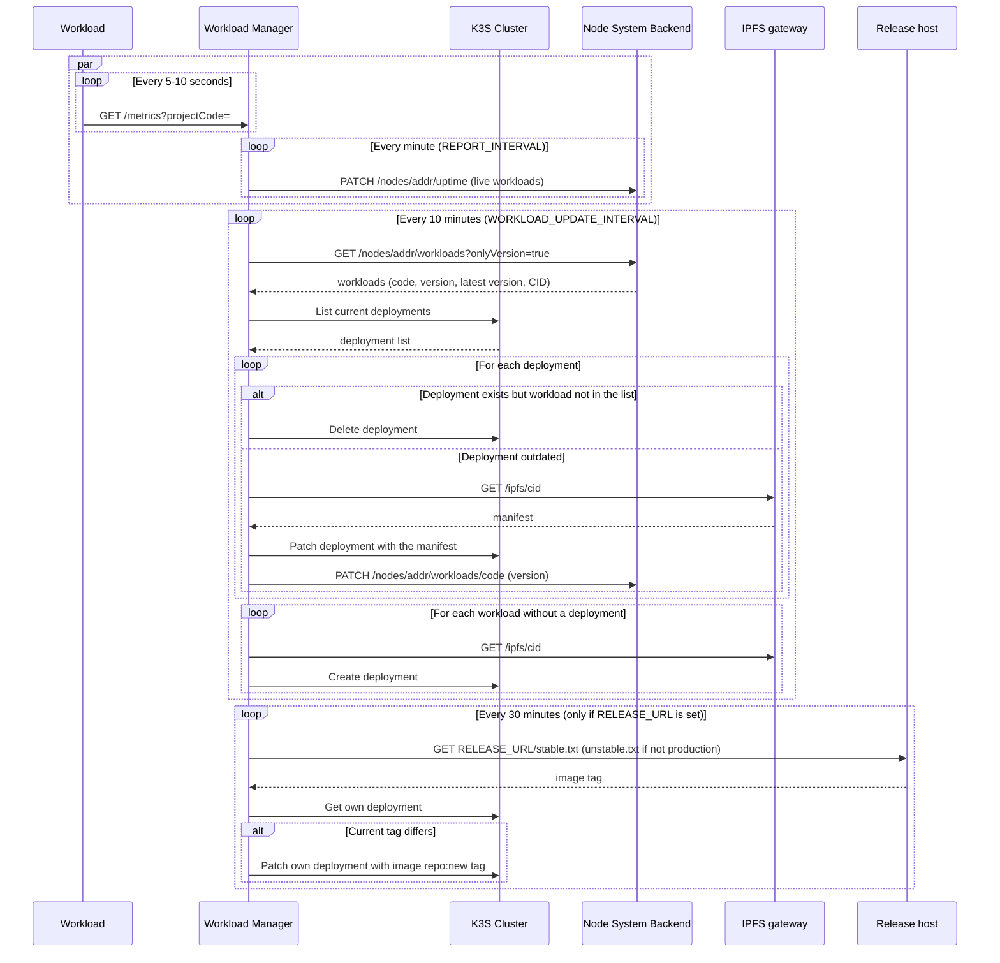

# Workload manager

Repository:
[`opensource-node-system-workload-management`](https://github.com/LFG-Incorporated/opensource-node-system-workload-management)
(TypeScript, Express). The repository README is the full reference.

The workload manager (Deployment `lfg-workload-manager`) runs inside the k3s cluster that
[`lfgnode`](node-cli.md) creates on an operator's machine. It is deployed and configured by the CLI;
operators never run it by hand. It has no config file: all configuration is environment variables on the
Deployment.

It is responsible for:

- **Workload version control.** Every `WORKLOAD_UPDATE_INTERVAL` (10 minutes) it asks the backend which
  workloads this node should run and at which version, downloads the Deployment manifests from an IPFS
  gateway and creates, patches or deletes Deployments in namespace `lfg-user`.
- **Uptime reporting.** Workloads call `GET :6161/metrics?projectCode=<code>` (about every 10 s); every
  `REPORT_INTERVAL` (60 s) the manager reports the set of live workloads to the backend
  (`PATCH /api/v1/nodes/<address>/uptime`, signed with the node key). The backend builds uptime sessions
  and reward data from this.
- **Health endpoint.** `GET :6161/health`.
- **Self-update (optional).** Every 30 minutes it reads a version file from the release host and patches
  its own Deployment to that image tag.

```
lfgnode (CLI) --creates--> k3d cluster "lfg-node"
                              |-- Deployment lfg-workload-manager   <-- this repo (image built by its CI)
                              |-- Deployment ipfs (kubo)
                              `-- Deployments of project workloads
workload-manager --HTTPS--> backend         workload list, uptime, version ack
workload-manager --HTTPS--> IPFS gateway    manifests by CID
workload-manager --HTTPS--> release host    stable.txt / unstable.txt (self-update)
workload-manager --k8s API-> cluster        apply / patch / delete Deployments
```

## Configuration

Validated at start-up with zod (`src/configs/env.ts`); the process exits if a required variable is
missing. A `.env` file is read in development.

| Variable | Required | Default | Meaning |
|---|---|---|---|
| `NODE_SYSTEM_ENDPOINT` | **yes** | none | Backend base URL, **https**, no trailing slash. Paths used: `/api/v1/nodes/<addr>/uptime`, `/api/v1/nodes/<addr>/workloads?onlyVersion=true`, `/api/v1/nodes/<addr>/workloads/<code>`. Set by the CLI from `api-endpoint` |
| `NODE_PRIVATE_KEY` | **yes** | none | Node private key (hex). Its address is the node id and signs every request (EIP-191). Set by the CLI |
| `IPFS_GATEWAY` | no | `https://ipfs.io` | Manifests are fetched from `<IPFS_GATEWAY>/ipfs/<cid>` (**https** only). Set by the CLI from `ipfs-gateway` |
| `RELEASE_URL` | no | empty = **self-update disabled** | Folder URL containing `stable.txt` / `unstable.txt` (a file whose entire content is an image tag), typically `https://<bucket-host>/workload-manager`. Set by the CLI |
| `SENTRY_DSN` | no | empty = disabled | Error-level logs with the node address as user id |
| `NODE_ENV` | no | `development` | `development`, `beta` or `production`. `production` self-updates from `stable.txt`, the others from `unstable.txt`. Set by the CLI |
| `KUBE_CONFIG` | no | empty | Kubeconfig content. If set, the manager targets `https://kubernetes.default.svc` with TLS verification off; if empty it loads the default kubeconfig (local development). Set by the CLI |
| `KUBECTL_CONTEXT` | no | `k3d-lfg-node` | Kube context. **Fixed name** ([Fixed names](fixed-names.md)) |
| `NAMESPACE` | no | `lfg-user` | Namespace of the workloads. **Fixed name** |
| `REPORT_INTERVAL` | no | `60000` | ms between uptime reports; also the freshness window of `/metrics` pings |
| `WORKLOAD_UPDATE_INTERVAL` | no | `600000` | ms between workload syncs |

Constants in code: self-update interval (30 min), HTTP port `6161`, and the system Deployments that are
never touched (`ipfs`, `lfg-workload-manager`).

## Behaviour



Details worth knowing:

- Manifests are only created or patched when their total CPU and memory **requests** fit in the host's
  CPUs and RAM.
- If a patch is rejected with HTTP 415 the Deployment is deleted and recreated.
- The system Deployments `ipfs` and `lfg-workload-manager` are excluded from the sync; **every other
  Deployment in `lfg-user` is treated as a workload**.
- The self-updater keeps the current image *repository* and changes only the tag, so the registry must
  hold the tag named in `stable.txt`.
- Workloads must ping at least once per `REPORT_INTERVAL` (the template pings about every 10 s): only
  pings from the last window count as alive.

### Rollout of new versions

The manager compares the node's own running `version` with the latest published version
(`projectWorkloadVersion`) and, when they differ, fetches the new manifest and patches the Deployment,
then reports the new version with `PATCH /nodes/<addr>/workloads/<code>`. A published version therefore
reaches running nodes within one sync (10 minutes).

!!! note "Backend fix required"
    Earlier backend builds answered `GET /nodes/:addr/workloads?onlyVersion=true` with the **latest** version
    in the `version` field, so the manager saw no difference and a new release **never reached running
    nodes**. The reference backend (branch `opensource-prep`) now returns the node's own running version.
    If you run an older backend build, update it.

### Backend endpoints used

| Method and path | Interval | Notes |
|---|---|---|
| `PATCH /api/v1/nodes/<addr>/uptime` body `{nodeAddress, time, workloads:[{projectCode}]}` | at start and every 60 s | signed (`X-Signature`) |
| `GET /api/v1/nodes/<addr>/workloads?onlyVersion=true` | every 10 min | unsigned; expects `{data:[{projectCode, version, projectWorkloadVersion, workloadCID, ...}]}`. `version` is the version **this node currently runs**, `projectWorkloadVersion` the latest published one; a difference makes the manager patch the Deployment ([note](#rollout-of-new-versions)) |
| `PATCH /api/v1/nodes/<addr>/workloads/<code>` body `{version, nodeAddress, time}` | after a workload upgrade | signed |

### When the backend is down

Reports and syncs fail with a warning and are retried on the next tick; running workloads keep running.
Nothing is credited while the backend is unreachable. A **non-200** response or a network error never
deletes anything. A **`200` with an empty list deletes all workloads** on every node within one sync
interval ([security](security.md#workload-manager)): be careful with backend deployments, database
resets and migrations. The reference backend answers `404` (code `1012`) for a node address it has never
registered, so a node pointed at a fresh backend keeps its workloads; registered nodes with no workloads
(and soft-deleted nodes) still get `200` and `[]`.

## Local development

```bash
cp .env.example .env     # NODE_SYSTEM_ENDPOINT (https) and NODE_PRIVATE_KEY
pnpm install
pnpm dev                 # ts-node-dev; needs a kubeconfig with context "k3d-lfg-node" (run lfgnode start first)
pnpm lint                # biome
```

Requires Node.js 22 and pnpm 9. Running outside the cluster is only for debugging. All outbound URLs must
be `https://` (a custom-DNS `https.Agent` is used for every request, so `http://localhost` backends do not
work) and names must resolve through the manager's **own resolver (public DNS)**: `/etc/hosts` names and
`localhost` fail.

For a local test use a TLS proxy in front of the backend plus a public wildcard DNS name such as
`<ip>.sslip.io`. With a self-signed certificate set `NODE_TLS_REJECT_UNAUTHORIZED=0` on the manager
Deployment. `lfgnode start` rewrites the Deployment, so patch it **after** start (full recipe: [Local
testing](local-testing.md#self-signed-tls-for-the-manager)):

```bash
kubectl -n lfg-user set env deploy/lfg-workload-manager \
  NODE_SYSTEM_ENDPOINT=https://<ip>.sslip.io:<tlsPort> \
  NODE_TLS_REJECT_UNAUTHORIZED=0 \
  RELEASE_URL-
```

(`RELEASE_URL-` removes the variable, which disables self-update.) In production use a real domain and
certificate.

## Build

```bash
pnpm install --frozen-lockfile
pnpm build               # tsc + tsc-alias, output in dist/
docker build -t my-registry/workload-manager:dev .     # multi-stage, node:22-slim
```

The container listens on **6161** (the `EXPOSE 3000` in the Dockerfile is a leftover) and starts with
`node index.js`.

## Releasing in your fork

`.github/workflows/deployment.yaml` runs on any pushed tag. It builds `linux/amd64` and `linux/arm64`,
pushes the image to **Amazon ECR Public**, and writes the tag to `workload-manager/stable.txt` (or
`unstable.txt` for tags containing `-rc`) in an S3 bucket. That bucket is the same one the CLI uses as
its `release-endpoint`, because the CLI reads `<release-endpoint>/workload-manager/stable.txt` to decide
which image tag to deploy.

| Kind | Name | Meaning |
|---|---|---|
| Variable | `ECR_REPOSITORY` | `<your-public-ecr-alias>/node-system/workload-manager`; image is `public.ecr.aws/<ECR_REPOSITORY>:<tag>` |
| Variable | `AWS_BUCKET` | S3 bucket (public read or behind a CDN) |
| Variable | `AWS_REGION` | region of the bucket |
| Secret | `AWS_ACCESS_KEY_ID`, `AWS_SECRET_ACCESS_KEY` | credentials allowed to push to ECR Public (us-east-1) and write the bucket |

Push a tag, check that `https://<bucket-host>/workload-manager/stable.txt` contains it, and configure the
CLI with `workload-manager-image=public.ecr.aws/<ECR_REPOSITORY>` and
`release-endpoint=https://<bucket-host>`. The repository must be publicly pullable. Use a version above
the last LFG release (`v0.3.3`). To publish somewhere else (for example GHCR) you must change the
workflow; the CLI only needs a pullable image name and the `stable.txt` file.

Both repositories must be released for the new manager to take effect: the manager reads its endpoints
from the variables the new CLI sets.

Without a release host (local tests, or any setup that pins the image): leave the CLI's `release-endpoint`
empty and set `workload-manager-image` to an **explicit tag**, for example
`ghcr.io/<org>/workload-manager:v1.0.0`. The CLI then deploys exactly that image and the manager gets no
`RELEASE_URL`, so **self-update is disabled** ([Node CLI](node-cli.md#configuration)). If you do use a release
endpoint over plain `http://` for a local test, the dev builds read `workload-manager/unstable.txt` (not
`stable.txt`), and the manager still cannot self-update over http.

## Names that must not change

`lfg-workload-manager` and port `6161`, namespace `lfg-user`, context `k3d-lfg-node`, Deployment `ipfs`,
ConfigMap `lfg-node-config`, Secret prefix `lfg-workload-`. See [Fixed names](fixed-names.md) for why.

## Layout

```
src/index.ts            Express app (port 6161), starts jobs
src/configs/env.ts      environment schema (all configuration)
src/jobs/               workloadUpdater (sync), reportMetrics (uptime), selfUpdater
src/routers/metric.ts   GET /metrics?projectCode=
src/services/           kube client, node wallet
src/utils/              dns (custom resolver), logger (pino + sentry transport), k8s helpers
```

Migrating from the LFG-hosted system: [Migration from LFG](migration-from-lfg.md).
