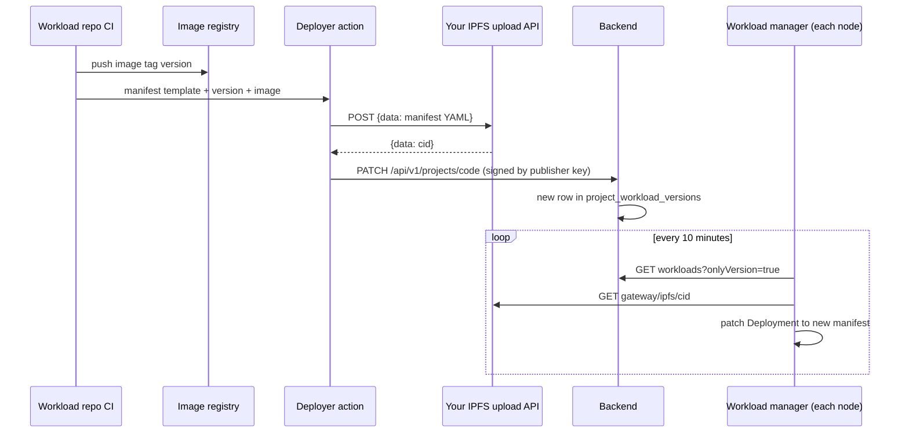

# Workloads: template, deployer and manifest rules

A **workload** is the container a project's operators run inside their node's cluster. Anything that
proves it is running by pinging the workload manager can be a workload. This page covers the template
repository, the deployer GitHub Action that publishes releases, the manifest rules the system enforces,
and the contracts between them.

| Repository | Role |
|---|---|
| [`opensource-nodesys-workload-template`](https://github.com/LFG-Incorporated/opensource-nodesys-workload-template) | NestJS template for a workload; its CI builds the image and runs the deployer |
| [`opensource-nodesys-deployer`](https://github.com/LFG-Incorporated/opensource-nodesys-deployer) | GitHub Action: completes the manifest, uploads it to IPFS, signs and publishes `{version, CID}` to the backend |



## Runtime contract provided by the node

The CLI creates, in namespace `lfg-user`:

- ConfigMap `lfg-node-config`:

  | Key | Meaning | Template env var |
  |---|---|---|
  | `nodeAddress` | The operator's node address | `NODE_ADDRESS` |
  | `healthBaseUrl` | Workload manager base URL (port `6161`) | `HEALTH_BASE_URL` |
  | `ipfsBaseUrl` | Kubo API URL inside the cluster | `IPFS_URL` |
  | `nodeServerBaseUrl` | Backend base URL (not used by the template) | none |

  Map these with `configMapKeyRef` in the manifest. The ConfigMap can also be mounted as a volume at
  `/etc/lfgNodeConfig`.
- Secret `lfg-workload-<code>` containing `REWARD_ADDRESS`, consumable with `envFrom` when the workload
  needs the operator's reward address.

Your workload must, in any language:

1. **Heartbeat.** Call `GET {HEALTH_BASE_URL}/metrics?projectCode=<project code>` at least every 60 s
   (the template does it every 10 s). The manager counts only pings from the last 60 s and forwards uptime
   to the backend.
2. Optionally, do the project's job and report to your own master.

The heartbeat is an unauthenticated local call: it proves a container is running, not that useful work was
done.

## Workload template

NestJS template. The sample job pins IPFS CIDs handed out by a master service (see the
[master sample](master-and-rewards.md#workload-master-sample)). Prerequisites for development: Node 22 or
newer, pnpm 9 or newer, Docker with compose.

```bash
pnpm install
cp .env.example .env        # NODE_ADDRESS (any ETH address) and MASTER_URL
docker compose up -d        # local kubo on :5001 (testing only)
pnpm start:dev
pnpm build && pnpm test
```

### Environment variables

Validated in `src/configs/index.ts` (`envalid`; the process exits on missing required values).

| Variable | Required | Default | Description |
|---|---|---|---|
| `MASTER_URL` | yes | | Base URL of your master service |
| `NODE_ADDRESS` | yes | | Node address (from the ConfigMap in production); sent to the master as `node_id` |
| `HEALTH_BASE_URL` | prod | `http://localhost` (dev only) | Workload manager URL for heartbeats |
| `IPFS_URL` | prod | `http://localhost:5001` (dev only) | Kubo API URL |
| `HEALTH_INTERVAL_SECONDS` | no | `5` | Heartbeat period. Cron granularity: `>=60` every minute, `>=30` every 30 s, otherwise every **10 s** |
| `PIN_INTERVAL_SECONDS` | no | `60` | IPFS job period, same granularity |
| `NODE_ENV` | no | `development` | `development` or `production`. **In `development` the heartbeat is skipped** |

The project code reported in the heartbeat is the `name` field of `package.json`; the `dockerfile`
overwrites it (and `version`) from the `PROJECT_CODE` / `VERSION` build args, so it must equal the project
code registered in your backend. **Pass both build args**: with only `PROJECT_CODE` the rewrite is silently
skipped. Build one image per project code.

The `dockerfile` **pins** pnpm (`npm install -g pnpm@9`): an unpinned install gets pnpm 11, which fails with
`ERR_PNPM_IGNORED_BUILDS` on `@nestjs/core`. The build also downloads `node-prune` from `gobinaries.com`, so
the build machine needs outbound internet access to that host.

### Master API contract used by the sample job

Base URL `MASTER_URL` (`src/modules/usecases/ipfs-distributor/ipfs-distributor.service.ts`):

```text
POST /api/v1/cids/list         body {"node_id": "<NODE_ADDRESS>"}
  -> {"data": {"cids": [{"cid": "<cid>", "created_at": <unix>}]}}
POST /api/v1/workload/report   body {"node_id": "<NODE_ADDRESS>", "oks": ["<cid>"], "fails": ["<cid>"]}
  -> any JSON (logged)
```

Each tick: list CIDs, pin each sequentially (`POST {IPFS_URL}/api/v0/pin/add?arg=<cid>`, 40 s timeout),
then report. If you need no master, remove `IpfsDistributorModule` from `src/app.module.ts` and drop
`MASTER_URL` from `configs`; keep `UphealthModule`.

In an isolated cluster (no route to the master's CIDs) the pin step times out after about 40 s per CID; this
is only a warning.

Known quirks kept as-is: the app listens on port `3000` while the manifest declares
`containerPort: 5002` (informational only), and `HEALTH_INTERVAL_SECONDS: '1'` in the manifest results in
the 10 s cron.

### CI: build, publish, release

`.github/workflows/deploy-workload.yaml` runs on pushes to `main`, `develop`, `cicd/*` and any tag. It logs
in to your registry (default `ghcr.io` with `GITHUB_TOKEN`), builds the `dockerfile` for
`linux/amd64,linux/arm64`, pushes `<image>:<version>`, then runs the deployer with
`manifest-template.yaml`.

| Name | Kind | Required | Default | Purpose |
|---|---|---|---|---|
| `PROJECT_PUBLISHER_PRIVATE_KEY` | secret | yes | | Publisher key; its address must be in `project_admins` on your backend |
| `NODESYS_BASE_URL` | variable | yes | | Backend base URL |
| `NODESYS_IPFS_API_URL` | variable | yes | | IPFS upload API URL ([contract below](#ipfs-upload-api-contract)) |
| `REGISTRY` | variable | no | `ghcr.io` | Registry host |
| `IMAGE_REPOSITORY` | variable | no | `<REGISTRY>/<owner>/<repo>` lower-cased | Image path without tag |
| `REGISTRY_USERNAME` / `REGISTRY_PASSWORD` | secrets | no | `github.actor` / `GITHUB_TOKEN` | Registry credentials |
| `PROJECT_CODE` | variable | no | repository name | Project code |

Before the first run: edit the `uses:` line of the `deploy` job to point at **your own deployer fork** at a
tag that includes the open-source changes (tags up to `v0.2.5` default to LFG hosts that no longer exist),
set `MASTER_URL` in `manifest-template.yaml` (placeholder `https://master.example.com`), and make the image
package **publicly pullable**, since the manifest references `<image>:<version>` directly. The
`dockerfile` sets `NODE_ENV=stage` for the build stage only; the runtime `NODE_ENV` comes from the
manifest (`production`). `fluxion-labs/versioning-action` is a third-party action pinned to a commit;
review it before bumping. Operators install the workload with `lfgnode workload add <project code>`.

**Every release needs a new version.** Publishing a version the backend already has is rejected with
`409` "Data already exists" (the step fails): bump the version (a new tag) instead of re-running the job. A
new version reaches running nodes within the workload manager's 10-minute sync
([Workload manager](workload-manager.md#behaviour)), provided the backend has the fix described there.

## Deployer (GitHub Action)

Publishes a workload release in three steps: complete the manifest template, upload it to IPFS through an
upload API you provide, sign `{projectCode, version, workloadIpfsCid}` with the publisher key and
`PATCH` it to your backend. No dependency on LFG infrastructure.

### Inputs

| Input | Required | Default | Description |
|---|---|---|---|
| `manifest` | yes | | Path to the manifest template (a Kubernetes `Deployment` YAML) |
| `publisher_private_key` | yes | | Hex private key of the publisher. Secret. Its address must be in `project_admins` |
| `code` | yes | | Project code (backend `projects.code`); also workload name and `app` label |
| `version` | yes | | Version string, for example `1.2.3`; also the image tag |
| `image` | yes | | Image repository **without tag**; the action sets `containers[0].image` to `<image>:<version>` |
| `baseurl` | yes | | Backend base URL; trailing `/` is stripped |
| `ipfs_api_url` | yes | | Full URL of your IPFS upload endpoint |

Behaviour change versus releases up to `v0.2.5`: `baseurl` no longer defaults to an LFG host,
`ipfs_api_url` is new and required, the signed payload no longer has a `legacy` field, signature headers
are no longer logged, and the unused `time` output was removed.

### Running the deployer locally

The action is plain Node: after building it, run `node dist/index.js` with the inputs as `INPUT_<NAME>`
environment variables (`INPUT_BASEURL`, `INPUT_IPFS_API_URL`, `INPUT_CODE`, `INPUT_VERSION`, `INPUT_IMAGE`,
`INPUT_MANIFEST`, `INPUT_PUBLISHER_PRIVATE_KEY`). The master sample's `POST /api/v1/static/text` satisfies
`ipfs_api_url`. Used by the [local test](local-testing.md).

### Manifest rules

The template is parsed as YAML and must have `metadata`, `spec` and `spec.template.spec` with a
`containers` array. The action then sets:

| Field | Value |
|---|---|
| `metadata.name` | `code` |
| `metadata.namespace` | `lfg-user` (fixed, not configurable) |
| `metadata.labels` | existing + `app: <code>`, `version: <version>` |
| `spec.selector.matchLabels` | existing + `app: <code>` |
| `spec.template.metadata.labels` | existing + `app: <code>`, `version: <version>` |
| `spec.template.spec.containers[0].name` | `main-container` |
| `spec.template.spec.containers[0].image` | `<image>:<version>` |

Everything else passes through. The action does **not** substitute `${VAR}`; the template must already be
final: the template's workflow does **not** run `envsubst` either, so edit the placeholders (for example
`MASTER_URL`) in `manifest-template.yaml` itself. The result is serialized with `js-yaml`
(`sortKeys: true`). Rules that follow from the system as a whole:

- The Deployment name is the project code. The workload manager matches Deployments to backend workloads by
  that name and treats **every Deployment in `lfg-user` other than `ipfs` and `lfg-workload-manager` as a
  workload**: a Deployment of any other name in that namespace is deleted at the next sync.
- Resource `requests` (CPU and memory) are checked against the host's totals before the manifest is applied.
  `privileged`, `hostPath`, `hostNetwork` etc. are not blocked ([Security](security.md#workload-manager)).
- Namespace `lfg-user`, ConfigMap `lfg-node-config` and secret `lfg-workload-<code>` are created by the CLI,
  not by the manifest.
- The image must be pullable anonymously by every operator's cluster.

### IPFS upload API contract

```text
POST {ipfs_api_url}
Content-Type: application/json
{ "data": "<manifest YAML as a string>" }
```

Expected response: 2xx JSON `{ "data": "<cid>" }`. The CID is logged and is what gets signed. Your service
must add the content to IPFS **and pin it** so operators' nodes and your gateway can resolve it. No
authentication header is sent, so protect the endpoint at the network level and keep it reachable from
GitHub runners. Minimal sketch (Node, Express, kubo):

```js
app.post("/api/v1/upload", express.json({ limit: "1mb" }), async (req, res) => {
  const { cid } = await ipfs.add(req.body.data, { pin: true });
  res.json({ data: cid.toString() });
});
```

The [master sample](master-and-rewards.md#workload-master-sample) offers `POST /api/v1/static/text`, which
satisfies this contract (the manifest CID then also joins the list nodes pin, and the endpoint is
unauthenticated).

### Publish request

```text
PATCH {baseurl}/api/v1/projects/{code}
X-User-Address: <publisher address>
X-Signature: <EIP-191 signMessage(body)>
{"projectCode":"<code>","version":"<version>","workloadIpfsCid":"<cid>"}
```

The body is the exact string that was signed (key order as shown); verify over the raw body. The signer must be in `project_admins` of the project or the request is rejected; any
non-2xx response fails the step.

### Usage

```yaml
name: publish
on:
  push:
    tags: ["v*"]
permissions: { contents: read, packages: write }
jobs:
  publish:
    runs-on: ubuntu-latest
    steps:
      - uses: actions/checkout@v4
      - uses: docker/login-action@v3
        with: { registry: ghcr.io, username: "${{ github.actor }}", password: "${{ secrets.GITHUB_TOKEN }}" }
      - run: |
          docker build -t ghcr.io/${{ github.repository }}:${{ github.ref_name }} .
          docker push ghcr.io/${{ github.repository }}:${{ github.ref_name }}
      - uses: <your-org>/opensource-nodesys-deployer@<tag-or-sha>
        with:
          manifest: manifest.yaml
          publisher_private_key: ${{ secrets.PROJECT_PUBLISHER_PRIVATE_KEY }}
          code: ${{ vars.PROJECT_CODE }}
          version: ${{ github.ref_name }}
          image: ghcr.io/${{ github.repository }}
          baseurl: ${{ vars.NODESYS_BASE_URL }}
          ipfs_api_url: ${{ vars.NODESYS_IPFS_API_URL }}
```

Development: `npm ci`, `npm run build` (ncc bundle into `dist/index.js`; **commit `dist/`**, the action runs
it with node20), `IPFS_API_URL=... npm test` (a manual smoke test that performs a real upload). Handling of
the publisher key (dedicated, no funds, rotate on leak) is in [Security](security.md#workload-tooling).
